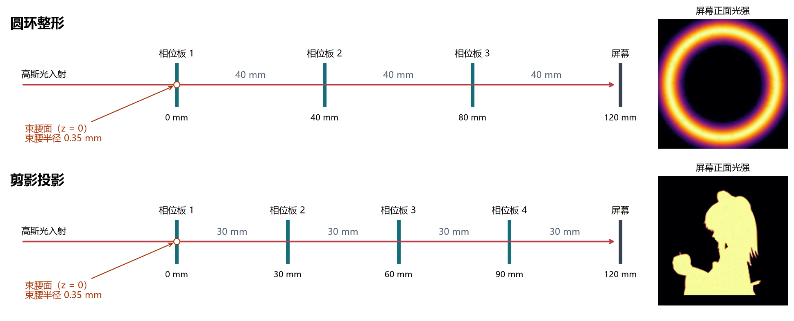
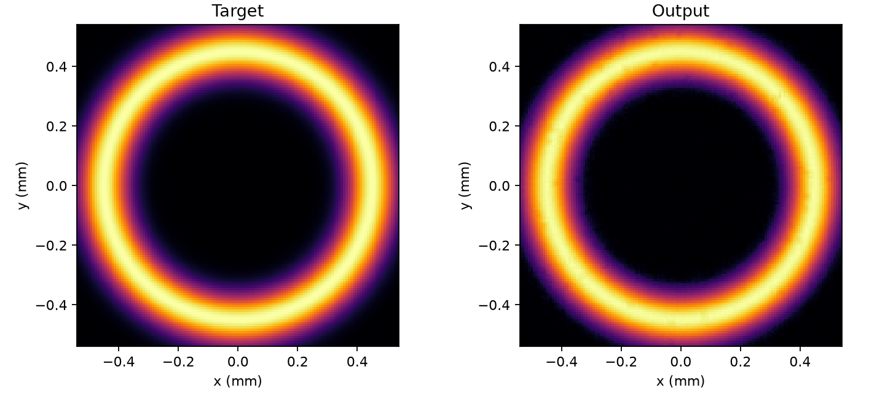
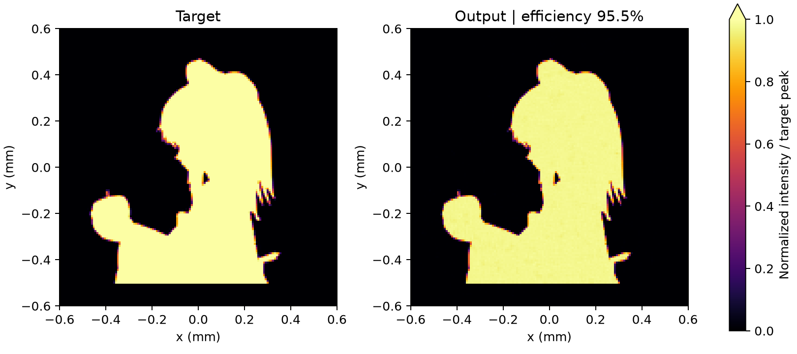
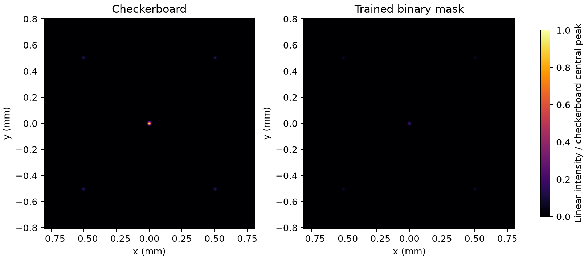

# D²NN 与二值衍射光学实验

这个项目研究一个具体的问题：怎样把给定的光送到希望它到达的位置？一组实验训练多层**相位板**，让高斯光变成圆环、投出人物剪影，或把不同输入送到不同的探测器。另一组实验设计单层**黑白振幅板**，让透过黑白图案的光在透镜后焦面形成剪影或四个光点。下文的光强图和效率均为数值仿真结果。

## 选择实验

| 实验 | 输入 → 输出 | 入口与结果 |
|---|---|---|
| 圆环光束整形 | 高斯光 → 指定半径的圆环 | 运行 [圆环训练](beam_shaping/train.py)，再用 [SciPy 传播复算](beam_shaping/replay_optics.py) 检查采样对结果的影响。 |
| 固定剪影投影 | 高斯光 → Bad Apple 人物和苹果 | 运行 [剪影训练](silhouette_shaping/train.py)。[目标图](silhouette_shaping/target.jpg) 放在脚本旁；默认让黑色剪影发亮。 |
| MNIST 分类 | 手写数字 → 十个探测区中能量最大的类别 | 在 `0-9classifier` 目录运行 [训练脚本](0-9classifier/train.py)，首次按需下载 MNIST。把照片放入 `test/`，运行 [照片识别](0-9classifier/predict_photos.py)，读取 `photo_results/` 中的预测。 |
| 模 97 加法 | 两个光点编码整数 → 97 个可能的和 | [训练脚本](mod97_grokking/train.py) 自行生成 9,409 个有序数对，按约 50% / 25% / 25% 划分训练、验证、测试集。[独立数据生成器](mod97_grokking/generate_data.py) 可另外导出样本。 |
| 二值振幅全息图 | 黑白透射板 + 透镜 → 离轴剪影 | 运行 [全息图优化](binary/train.py)，读取 [目标图](binary/target.jpg)，将掩模、焦面图、效率曲线保存到 `binary/hologram_时间戳/`。 |
| 四点分光器 | 黑白透射板 + 透镜 → 四个对称衍射点 | [棋盘格设计](binary/four_spot/design.py) 生成基准；[二值搜索](binary/four_spot/train.py) 生成优化板，并与基准比较。两个脚本都可单独运行。 |

## 快速开始

使用带 NumPy、PyTorch、torchvision、SciPy、Pillow 和 Matplotlib 的 Python 环境。在 IDLE 中打开上表的脚本，按 **F5**。两个光束整形脚本各自包含网络定义，参数在各自文件顶部修改。PyTorch 实验支持 CUDA；黑白振幅板的设计和优化使用 NumPy 在 CPU 上运行。

```bash
python -m pip install numpy torch torchvision scipy pillow matplotlib
```

在项目根目录任选一条命令即可开始。例如，第一条直接生成四点分光板的可打印图样，第二条针对同一光路优化黑白格，第三条训练圆环相位板。

```bash
python binary/four_spot/design.py
python binary/four_spot/train.py
python beam_shaping/train.py
```

圆环与剪影训练在各自的 `output/` 下保存 `weights.npz`（相位、配置和训练记录）、`weights.csv`（带坐标的相位权重）、`phase_plates.png`（相位图）和 `ring.png` 或 `result.png`（目标与输出）。下次训练会更新同名文件。每个脚本只使用自己目录中的设置；更换剪影目标时，可修改 `TARGET_FILE` 和 `BRIGHT_SILHOUETTE`。

## 实验装置示意图



左侧是仿真光路的侧视图，右侧是对应的屏幕光强。两套装置都使用波长 **640 nm** 的高斯光。第一块相位板的入射面取为 **z = 0**，入射光的束腰就在这个面上，束腰半径为 **0.35 mm**，波前为平面。

- **圆环整形（上图）**：三块相位板位于 0、40、80 mm，屏幕位于 120 mm。每块板之后传播 40 mm。
- **剪影投影（下图）**：四块相位板位于 0、30、60、90 mm，屏幕同样位于 120 mm。每块板之后传播 30 mm。

### 光学参数与代码变量

下表对应图中的两套装置。脚本中未标注单位的长度参数均以米为单位；`TARGET_LONG_SIDE_MM` 以毫米为单位。

| 物理量 | 代码变量 | 圆环整形 | 剪影投影 |
|---|---|---:|---:|
| 入射波长 λ | `WAVELENGTH` | 640 nm | 640 nm |
| 束腰半径 w₀（光强降至峰值的 1/e² 处） | `WAIST` | 0.35 mm | 0.35 mm |
| 束腰位置 | 由输入光场定义，无单独变量 | 第 1 块板入射面，z = 0 | 第 1 块板入射面，z = 0 |
| 相位板数量 | 圆环 `LAYERS_TO_TRAIN`；剪影 `LAYERS` | 3 | 4 |
| 第一块板至屏幕的总距离 | `TOTAL_DISTANCE` | 120 mm | 120 mm |
| 每段自由传播距离 | 局部变量 `z = TOTAL_DISTANCE / layers` | 40 mm | 30 mm |
| 每块板的分辨率 | `PIXELS`（每边格数） | 256 × 256 | 256 × 256 |
| 相位格子宽度 | `PITCH` | 16 µm | 16 µm |
| 相位板边长 | `PIXELS * PITCH` | 4.096 mm | 4.096 mm |
| 每个格子的传播采样 | `SAMPLES_PER_PIXEL`（每边点数） | 2 × 2 | 2 × 2 |
| 补零窗口宽度 / 板宽 | `WINDOW_FACTOR` | 2 | 2 |
| 输出目标尺寸 | 圆环 `RADIUS`、`WIDTH`；剪影 `TARGET_LONG_SIDE_MM` | 半径 0.45 mm，径向宽度参数 0.06 mm | 图片长边 1.0 mm |

### 相位板权重 CSV

[圆环装置权重（三块板）](beam_shaping/output/weights.csv) · [剪影装置权重（四块板）](silhouette_shaping/output/weights.csv)

每个 CSV 有 65,536 行数据，每行对应板面上的一个格子。`row` 和 `col` 是从 0 开始的行列索引，`x_mm` 和 `y_mm` 是格子中心相对光轴的坐标。列号沿 +x 增大，行号沿 +y 增大。`plate_1_rad` 是入射光遇到的第一块板的相位，后续各列按光路顺序排列。相位以弧度保存，保留训练得到的原始值；画相位图时才折叠到 0～2π。两份训练脚本完成后都会从当次权重重新导出 CSV。

## 两个光场设计实例

**光束整形：高斯光束变圆环。** 左图是目标光强，右图是光经过三块相位板后在屏幕上形成的圆环。



**固定图案投影：Bad Apple 剪影。** 左图指定人物和苹果的位置，右图显示同一束高斯光经过为这幅图案训练的相位板后的光强分布。



[圆环的相位板](docs/images/ring-phases.png) · [剪影的相位板](docs/images/silhouette-phases.png)

## 黑白振幅板：焦面全息与四点分光

两项实验都用 **640 nm 平坦波前高斯光 → 黑白透明片 → 200 mm 焦距透镜 → 后焦面**。透明片紧靠透镜，白格透光、黑格遮光。这里脚本的长度单位是 **mm**，所以同一波长写成 `WAVELENGTH = 0.000640`。中央的亮点称为零级光；对平坦入射波前，透明格在正中心同相叠加。压低零级时要同时检查目标能量是否也被削弱。

### 单层全息图

[二值全息脚本](binary/train.py) 用 96 × 96 个宽 0.10 mm 的格子，在 9.60 mm 宽的胶片上编码图案；优化目标是让焦面上距光轴约 0.32 mm 的区域出现人物剪影。连续透射率预热后，前向计算使用黑白两种状态。一次保存的设计中，右侧剪影亮区接收到约 **6.00%** 的板面入射功率。局部归一化的图适合看轮廓；以全场峰值为基准的线性图更能显示它与中央亮点之间的亮度差。[黑白器件图样](binary/hologram_20261108_145807/binary_mask.png) · [剪影局部与全场示例](binary/hologram_20261108_145807/result.png) · [线性焦面光强](binary/hologram_20261108_145807/screen_linear.png)

### 四点分光器

两种设计的有效边长都是 **9.652 mm**，周期为 **0.254 mm**，四个目标位于 $(x,y)=(\pm0.504,\pm0.504)$ mm。基准使用黑白相间的棋盘格。优化版把一个周期分为 4 × 4 格，搜索各格的开关，再周期性平铺。增大 `ZERO_WEIGHT` 会更强调压低零级，`BALANCE_WEIGHT` 控制四点之间的功率差。

| 理想仿真，假设板面入射功率 2 mW | 棋盘格基准 | 优化黑白板 |
|---|---:|---:|
| 每个角点功率 | 82.1 µW | 41.1 µW |
| 四点合计占入射功率 | 16.42% | 8.21% |
| 中央零级功率 | 500 µW | 125 µW |

功率在每个点周围半径 0.08 mm 的圆内积分。优化结果保持四点等亮，中央功率降至基准的四分之一，单个目标点的功率也降至约一半。[逐点功率 CSV](binary/four_spot/trained_output/power.csv)



棋盘格脚本写入 `binary/four_spot/output/`，优化脚本写入 `binary/four_spot/trained_output/`。打印[优化板 SVG](binary/four_spot/trained_output/mask_1to1.svg) 或 [PNG](binary/four_spot/trained_output/mask_1to1.png) 时选 **100% 实际尺寸**，关闭适应页面，并核对图案边长。优化板最小格宽为 0.0635 mm，对应 1200 dpi 下的 3 个打印点；实际对比度和效率取决于胶片透过率、墨层遮光和打印精度。

## D²NN 擅长什么？

对于这里的单色、相干、纯相位 D²NN，最直接的任务是**控制光在空间里如何分布**。例如，输入中心最亮的高斯光，要求它在 120 mm 外形成圆环，目标就可以直接写成屏幕上的光强图。每张相位板改变光波各部分的相位，经传播和干涉，能量在不同位置重新分布。

| 任务 | 适用程度与原因 |
|---|---|
| 光束整形、固定图案投影 | 与器件的工作方式直接匹配。圆环和剪影实验分别把一束固定的高斯光变成指定图案。每换一个目标，当前脚本就要重新设计相位板。 |
| 空间滤波、光学模式变换 | 输入、输出都是光场，适合设计固定的空间变换。例如，可以针对高通滤波或特定输入模式的能量路由设计衍射层。[衍射层实现线性变换的研究](https://www.nature.com/articles/s41377-021-00623-5) |
| 类别固定、输入条件受控的图像识别 | 可以把不同类别的光送往不同探测区，以能量最大的区域作为预测。原始 D²NN 工作演示过手写数字分类；相机拍摄的照片还涉及光照、裁切、笔画粗细等分布变化。[D²NN 原始论文](https://doi.org/10.1126/science.aat8084) |
| 精确算术、条件分支、需要记忆的序列任务 | 对本项目的架构，这些通常不是优先选项。输入数字需要先编码成光场；固定相位板一路向前传播，没有保存上一步结果的状态。对于模 97 加法，直接计算 `(a + b) % 97` 就能对全部输入给出精确答案，而训练光学分类器还要检验未见组合上的正确率。 |

这种差别来自网络结构。相位板固定后，每层的相位调制和自由传播对**复光场**都是线性的，叠加多层仍得到一个线性变换；屏幕测量光强时才取模平方。更多层可以增加可实现的光场变换，但不会自动提供普通深度网络的逐层非线性、条件控制或记忆。对传统机器学习任务，是否合适取决于输入怎样编码、输出怎样读取，以及对新样本的泛化要求。[衍射网络的光学信息处理能力](https://pmc.ncbi.nlm.nih.gov/articles/PMC7844294/)

## 怎样读实验结果

- **相位像素与仿真采样**：`PIXELS` 改变器件每边有多少个可训练格子。`SAMPLES_PER_PIXEL` 改变每格用了多少传播采样点；格内仍共享一个相位。比较同一组相位板时应固定物理尺寸，用更细的网格检查输出是否稳定。
- **效率与图案质量**：效率是指定区域内的功率除以入射功率。圆环实验统计 `RADIUS ± 2 × WIDTH` 的环带，剪影实验统计目标亮区。即使效率很高，亮区内部也可能不均匀。局部图各自按峰值缩放时，不能直接用颜色比较绝对亮度。
- **分类与泛化**：数字识别要区分 MNIST 测试准确率和实拍照片识别率。模 97 实验可观察训练准确率先达到高位、验证准确率是否在长时间后才上升；训练脚本按验证集表现选权重，最后再评估独立测试集。目录用于检验 grokking 是否出现，结论取决于实际曲线。
